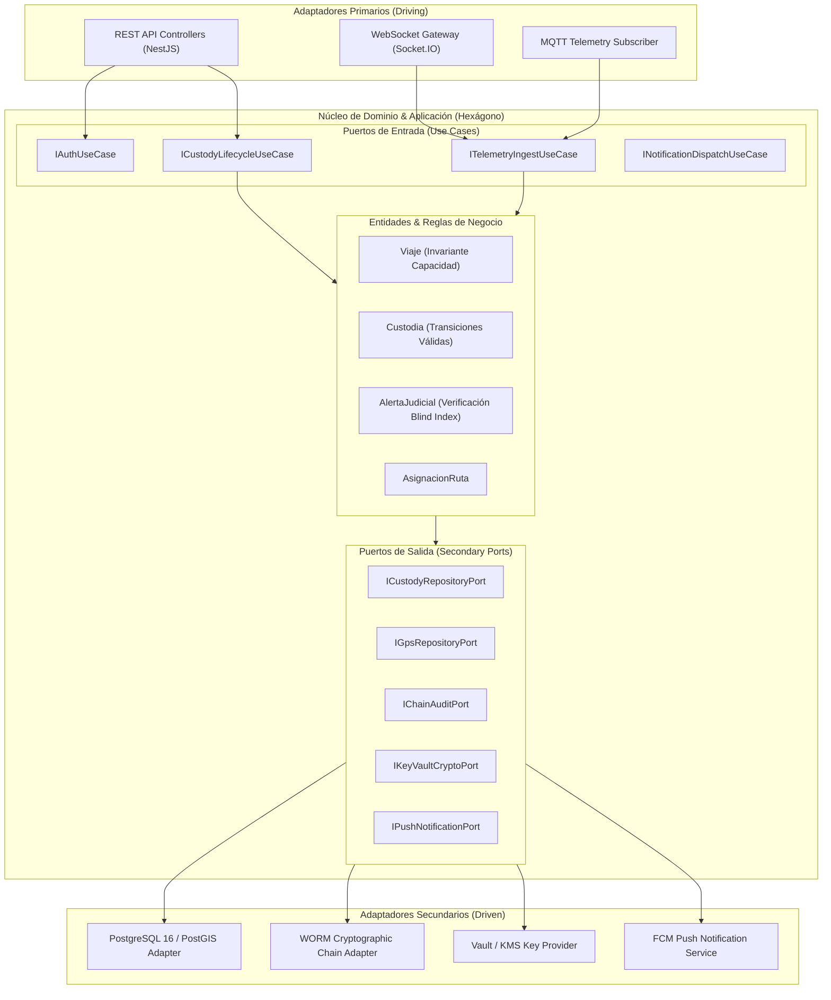

# Camino Seguro — Backend Core API & Telemetry Engine

[](https://github.com/Code-Dev-2026/backend/actions/workflows/ci.yml)
[](https://nodejs.org/)
[](https://nestjs.com/)
[](https://www.postgresql.org/)
[](https://socket.io/)
[](https://mqtt.org/)
[](https://owasp.org/www-project-application-security-verification-standard/)
[](https://en.wikipedia.org/wiki/SOLID)

---

# Propósito

El sistema **Camino Seguro** es una plataforma integral de misión crítica concebida para salvaguardar la **cadena de custodia física y digital de menores de edad** en el transporte escolar del **Colegio San Benito del Otún** (Pereira, Risaralda), operado en convenio con la empresa **Transportes Camino Seguro S.A.S.**.

El backend constituye el núcleo de gobernanza, orquestación telemática vehicular, control transaccional de abordajes y descensos mediante códigos QR dinámicos, auditoría forense inmutable basada en encadenamiento criptográfico y despacho de eventos en tiempo real hacia las familias y la coordinación institucional.

---

# Alcance

### Lo que Incluye (SRS Sección 1.2)
- **Control Biunívoco de Cadena de Custodia:** Registro de eventos de abordaje y desembarque con validación estricta de receptor (Acudiente titular o Adulto Autorizado activo, máximo 3 por estudiante).
- **Protección Judicial Preventiva:** Detección de mandatos judiciales activos (restricciones de acercamiento) mediante blind indexing, bloqueando de inmediato la entrega física al individuo restringido y activando protocolos de contingencia hacia la sede escolar.
- **Telemetría e Ingesta IoT en Tiempo Real:** Recepción de coordenadas GPS vehiculares a través de MQTT/HTTPS (latencia objetivo < 2,5 s per RNF-05), con particionamiento mensual y cálculo geográfico PostGIS.
- **Aislamiento Multi-rol y Privacidad Familiar:** Segmentación estricta (RNF-02) garantizando que cada acudiente consulte únicamente a sus menores a cargo y acceda a la telemetría en vivo del vehículo exclusivamente mientras el menor se encuentre físicamente a bordo.
- **Sincronización Offline Resiliente:** Mecanismo de persistencia local en SQLite (app monitora) y sincronización idempotente hacia el backend mediante llaves UUIDv7 y detección de duplicidad.
- **Auditoría Forense Criptográfica WORM:** Bitácora inmutable con encadenamiento SHA-256 secuencial protegido por candado consultivo de transacción (`pg_advisory_xact_lock`).
- **Esquema Financiero Aislado:** Módulo segregado `billing` para cartera, facturación mensual y registro de pagos, inaccesible para los roles de operación logística.

### Lo que No Incluye (SRS Sección 1.2)
- Procesamiento bancario directo de pasarelas de pago (se registra el comprobante o referencia; la liquidación interbancaria es externa).
- Dispositivos de hardware físico GPS o cámaras a bordo (el backend provee únicamente las interfaces de ingesta de telemetría y contratos telemáticos).
- Rutas intermunicipales o turismo no vinculado al calendario escolar del Colegio San Benito del Otún.

---

# Objetivos

1. **Garantizar Cero Pérdidas de Custodia:** Proporcionar trazabilidad milimétrica en cada transición de estado del estudiante (`EN_CASA` $\rightarrow$ `A_BORDO_VEHICULO` $\rightarrow$ `EN_COLEGIO` $\rightarrow$ `RETORNO_SEDE_POR_FALLA_ENTREGA`).
2. **Alta Concurrencia y Resistencia a Condiciones Adversas:** Soporte de operación en zonas de sombra celular con cola de sincronización diferida y control atómico de sobrecupo concurrente (`UPDATE ... WHERE total_a_bordo < capacidad`).
3. **Privacidad Reforzada (Habeas Data):** Cumplimiento riguroso de la Ley Estatutaria 1581 de 2012 y OWASP ASVS Nivel 2: cifrado de información sensible (AES-256-GCM) y búsquedas mediante índices ciegos deterministas (HMAC-SHA256).
4. **Respuesta Sub-segundo:** Despacho de notificaciones push críticas y alertas de desvío de ruta en menos de 2,5 segundos hacia las aplicaciones móviles.

---

# Stack Tecnológico Oficial

| Capa | Tecnología | Justificación y Rol en el Proyecto |
| :--- | :--- | :--- |
| **Runtime & Lenguaje** | **Node.js 20 LTS + TypeScript 5.x** | Ejecución asíncrona no bloqueante, tipado estricto de contratos y alta concurrencia. |
| **Framework Backend** | **NestJS 10.x** | Arquitectura modular orientada a inyección de dependencias (DIP) y separación limpia de capas. |
| **Base de Datos Principal** | **PostgreSQL 16 + PostGIS 3.4** | Motor relacional transaccional ACID con soporte geoespacial nativo (GiST, geography Point/LineString). |
| **Base de Datos Móvil Offline** | **SQLite 3 (Móvil)** | Almacenamiento local en dispositivo de monitora con cola de sincronización idempotente. |
| **Eventos en Tiempo Real** | **Socket.IO 4.x** | Emisión bidireccional de eventos y seguimiento de ruta en vivo hacia las familias y monitores. |
| **Protocolo Telemetría IoT** | **MQTT v5 / TLS (MQTTS)** | Ingesta ligera y de bajo consumo de paquetes GPS desde terminales vehiculares. |
| **Autenticación & Sesión** | **JWT + Argon2id + TOTP MFA** | Autenticación stateless con rotación segura de refresh tokens (detección de reutilización) y MFA. |
| **Notificaciones Push** | **Firebase Cloud Messaging (FCM)** | Entrega masiva y dirigida de notificaciones operativas y alertas institucionales críticas. |

---

# Arquitectura de Software

El sistema backend adopta una **Arquitectura Hexagonal (Puertos y Adaptadores)** combinada con principios **Domain-Driven Design (DDD)** y estricta adherencia a **SOLID**:



### Aplicación de Principios SOLID en el Backend
- **Single Responsibility Principle (SRP):** Cada caso de uso (ej. `RegistrarAbordajeUseCase`, `ValidarReceptorEntregaUseCase`) resuelve una única regla de negocio. Los servicios de persistencia, cifrado y despacho de notificaciones están desacoplados.
- **Open/Closed Principle (OCP):** El motor de alertas (`AlertaMotorService`) permite suscribir nuevos detectores (desvío de ruta, geocerca, velocidad, detención no autorizada) mediante una interfaz unificada sin alterar el procesador central.
- **Liskov Substitution Principle (LSP):** Todas las implementaciones de repositorios y clientes de notificación implementan interfaces abstractas sustituibles sin alterar invariantes.
- **Interface Segregation Principle (ISP):** Interfaces pequeñas y específicas para cada consumidor (ej. `IReadableCustodyState`, `IAppendOnlyAuditChain`, `IGpsStreamPublisher`).
- **Dependency Inversion Principle (DIP):** Las entidades de dominio no conocen TypeORM, PostGIS ni FCM. Dependen exclusivamente de abstracciones de puertos.

---

# Modelo de Datos y Seguridad ASVS Nivel 2

El modelo de datos consolidado comprende **42 entidades y relaciones** estructuradas en dos esquemas (`public` y `billing`), documentado exhaustivamente en:
- [Diagrama Entidad-Relación Consolidado (Mermaid)](docs/er.md)
- [Matriz de Trazabilidad con Requisitos SRS v2.0](docs/trazabilidad-srs.md)
- [Registro de Supuestos, Propuestas y Decisiones Pendientes](docs/supuestos-y-propuestas.md)

### Pilares de Seguridad Implementados:
1. **Identificadores Anti-Enumeración:** Claves primarias generadas mediante **UUIDv7** ordenables cronológicamente, mitigando ataques IDOR y preservando rendimiento en índices B-Tree.
2. **Cifrado en Reposo de Datos Sensibles:** Formato estándar `key_version:iv:tag:ciphertext` (AES-256-GCM). Identificaciones y teléfonos de acudientes y autorizados cuentan con búsqueda exacta vía **Blind Index HMAC-SHA256**.
3. **Auditoría Forense Criptográfica (WORM):** Tablas `bitacora_auditoria` e `historial_estado_custodia` encadenan hashes SHA-256 de forma atómica bajo candado consultivo `pg_advisory_xact_lock(9876543210)`. Triggers de base de datos impiden de forma absoluta cualquier `UPDATE`, `DELETE` o `TRUNCATE`.
4. **Row-Level Security (RLS) y Segregación:** RLS activo en `estudiante`, `registro_gps` y `notificacion`. El acudiente solo puede visualizar datos de sus propios hijos y telemetría mientras el estudiante permanezca a bordo (`A_BORDO_VEHICULO`).

---

# Migraciones de Base de Datos (DDL)

Las migraciones se encuentran secuenciadas en `db/migrations/`:
- `V001__init_extensions_and_roles.sql`: PostGIS, pgcrypto, btree_gist, roles de base de datos (`app_owner`, `app_user`, `app_user_operations`, `app_user_billing`).
- `V002__identity_and_access.sql`: Colegio, roles RBAC, usuarios, conductores, coordinadores, acudientes, refresh tokens y backup codes.
- `V003__students_and_custody_vault.sql`: Estudiantes, adultos autorizados (máx. 3), expediente cifrado y alertas judiciales.
- `V004__geospatial_routes_and_zones.sql`: Rutas, paradas GiST Point, geocercas poligonales de Pereira y asignaciones biunívocas.
- `V005__trips_and_gps_partitions.sql`: Viajes con exclusión btree_gist para solapamientos, telemetría GPS particionada mensualmente y función de mantenimiento.
- `V006__attendance_and_custody_lifecycle.sql`: Asistencia QR, transiciones atómicas de abordaje/descenso, bloqueo judicial en entrega y cadena de custodia.
- `V007__notifications_and_offline_sync.sql`: Tokens FCM, cola de notificaciones, comunicados institucionales y sync idempotente.
- `V008__forensic_audit_trail.sql`: Bitácora forense encadenada con SHA-256 e inmutabilidad estricta.
- `V009__billing_isolated_schema.sql`: Esquema `billing` con cartera, facturas y pagos mensuales.
- `V010__security_rls_and_permissions.sql`: Asignación de propietarios, permisos mínimos y políticas de Row-Level Security.

---

# Estado de Validación DDL

> [!NOTE]
> **ESTADO DE VALIDACIÓN: VALIDADO AL 100% EN PIPELINE DE INTEGRACIÓN CONTINUA (CI)**
> Las 10 migraciones de base de datos (`V001` a `V010`) y la suite de pruebas de integridad y reglas de negocio (`test_suite_camino_seguro.sql`) han sido ejecutadas y **validadas satisfactoriamente al 100%** contra un contenedor oficial de **PostgreSQL 16 + PostGIS 3.4** en GitHub Actions (`.github/workflows/ci.yml`).
>
> ### Resultados Verificados:
> - **Generador UUIDv7 (RFC 9562):** Validación cronológica libre de desbordamiento de enteros.
> - **Control Atómico Anti-Sobrecupo:** Reintento con capacidad nominal agotada bloqueado con código `DENEGADO_SOBRECUPO` y registro de incidente.
> - **Integridad Criptográfica de Custodia:** Función `fn_verificar_integridad_custodia` retornando `es_valido = true`.
> - **Descenso y Entrega Segura:** Descenso atómico con validación de receptores y decremento atómico de aforo verificado.
> - **Bitácora Forense WORM:** Encadenamiento secuencial SHA-256 verificado con `cadena_integra = true`.
> - **Políticas de Row-Level Security (RLS):** Aislamiento familiar y condición de telemetría GPS en vivo vinculada al estado `A_BORDO_VEHICULO`.

---

# Estructura del Repositorio

```
backend/
├── .github/
│   ├── ISSUE_TEMPLATE/
│   │   ├── bug_report.yml
│   │   ├── feature_request.yml
│   │   ├── security_issue.yml
│   │   └── config.yml
│   └── workflows/
│       └── ci.yml
├── db/
│   ├── migrations/
│   │   ├── V001__init_extensions_and_roles.sql
│   │   ├── V002__identity_and_access.sql
│   │   ├── V003__students_and_custody_vault.sql
│   │   ├── V004__geospatial_routes_and_zones.sql
│   │   ├── V005__trips_and_gps_partitions.sql
│   │   ├── V006__attendance_and_custody_lifecycle.sql
│   │   ├── V007__notifications_and_offline_sync.sql
│   │   ├── V008__forensic_audit_trail.sql
│   │   ├── V009__billing_isolated_schema.sql
│   │   └── V010__security_rls_and_permissions.sql
│   └── tests/
│       └── test_suite_camino_seguro.sql
├── docs/
│   ├── er.md
│   ├── supuestos-y-propuestas.md
│   └── trazabilidad-srs.md
├── .env.example
├── .gitignore
├── CODEOWNERS
├── CONTRIBUTING.md
├── LICENSE
├── PULL_REQUEST_TEMPLATE.md
├── README.md
└── SECURITY.md
```

---

# Configuración y Variables de Entorno

Copiar la plantilla de configuración e ingresar los secretos correspondientes a través del gestor de credenciales:

```bash
cp .env.example .env
```

Consultar la documentación detallada de cada variable en [.env.example](.env.example).

---

# Integrantes

- **Jhonatan Mauricio Muchavisoy Jajoy**
- **Aura Camila Arteaga Castillo**
