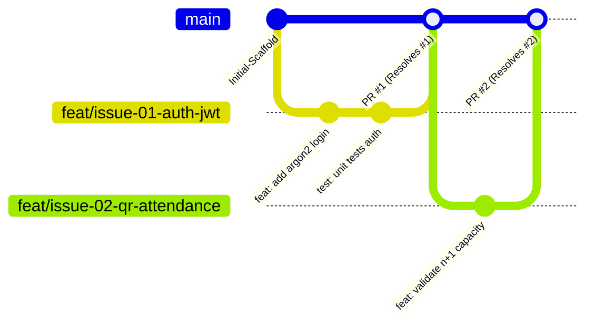

# Camino Seguro — Backend API & Telemetry Engine

[](https://github.com/Code-Dev-2026/backend/actions/workflows/ci.yml)
[](https://nodejs.org/)
[](https://nestjs.com/)
[](https://www.postgresql.org/)
[](https://socket.io/)
[](https://mqtt.org/)
[](https://owasp.org/www-project-application-security-verification-standard/)
[](https://en.wikipedia.org/wiki/SOLID)

> **Sistema de Control Operativo y Seguridad para Rutas Escolares del Colegio San Benito del Otún y Transportes Camino Seguro S.A.S.**  
> Backend de misión crítica desarrollado en **NestJS con TypeScript**, base de datos relacional y geoespacial **PostgreSQL 16 + PostGIS 3.4**, broker **MQTT Mosquitto** y colas/caché con **Redis**. Implementado bajo **Clean Architecture**, principios **SOLID**, gobernanza de cadena de custodia de menores y estricto cumplimiento de la **Ley 1581 de 2012 (Habeas Data Menores)** con cifrado **AES-256-GCM** e indexación ciega **HMAC-SHA256**.

---

## 📋 Requisitos Previos

Antes de comenzar, asegúrate de tener instalado en tu máquina de desarrollo:

* **Node.js**: `v20.x LTS` o superior (`v20.14.0+` o `v22.x` recomendados).
* **npm**: `v10.x` o superior (incluido con Node.js).
* **Docker & Docker Compose**: Docker Engine `v24+` o Docker Desktop actualizado con soporte para `docker compose`.
* **Git**: `v2.40+`.

---

## 🚀 Guía de Inicio Rápido (Post-Clonación en menos de 5 minutos)

Sigue estos 8 pasos secuenciales para tener el entorno de desarrollo 100% operativo:

### Paso 1: Clonar el repositorio
Abre tu terminal y clona el proyecto en tu máquina local:

```bash
git clone https://github.com/Code-Dev-2026/backend.git
cd backend
```

---

### Paso 2: Instalar las dependencias
Instala los paquetes de producción y desarrollo de NestJS:

```bash
npm install
```

---

### Paso 3: Configurar variables de entorno
Copia la plantilla `.env.example` para crear tu archivo `.env` local:

```bash
# En Windows (PowerShell) o Linux/macOS:
cp .env.example .env
```

#### 🔑 Variables indispensables ya preconfiguradas para desarrollo local:
* **`DB_*`**: Conexión a PostgreSQL (`DB_HOST=localhost`, `DB_PORT=5432`, `DB_NAME=camino_seguro_db`, `DB_USER=app_user`, `DB_PASSWORD=dev_app_user_password_2026`).
* **`REDIS_*`**: Conexión a Redis (`REDIS_HOST=localhost`, `REDIS_PORT=6379`, `REDIS_PASSWORD=dev_redis_secret_password`).
* **`JWT_*`**: Secretos criptográficos para la firma y rotación de tokens (`JWT_ACCESS_SECRET`, `JWT_REFRESH_SECRET`).
* **`APP_ENCRYPTION_MASTER_KEY`**: Llave maestra de 32 bytes (AES-256-GCM) para cifrar datos sensibles de menores bajo la Ley 1581. Formato en reposo: `v1:iv:tag:ciphertext`.
* **`APP_BLIND_INDEX_HMAC_KEY`**: Llave HMAC-SHA256 para indexado ciego de documentos, permitiendo búsquedas exactas sin desencriptar la base de datos.
* **`MQTT_BROKER_URL`**: Conexión al broker telemático local (`mqtt://localhost:1883`).

---

### Paso 4: Levantar la infraestructura local con Docker Compose
Inicia los servicios de PostgreSQL con PostGIS, Mosquitto MQTT y Redis en segundo plano:

```bash
docker compose up -d
```

Verifica que los tres contenedores estén en estado saludable (`healthy` o `Up`):

```bash
docker compose ps
```

> **Servicios expuestos:**
> * 🐘 **PostgreSQL 16 + PostGIS 3.4**: Puerto `5432`
> * 🦟 **Mosquitto MQTT**: Puerto `1883` (TCP) y `9001` (WebSockets)
> * 🔴 **Redis 7**: Puerto `6379`

---

### Paso 5: Ejecución y verificación de migraciones de base de datos
El contenedor de PostgreSQL monta e inicializa automáticamente las migraciones en `/docker-entrypoint-initdb.d/`. Si necesitas ejecutarlas o revertirlas manualmente con TypeORM CLI:

```bash
# Validar conexión y estado de base de datos
npm run typeorm query "SELECT version(), PostGIS_Full_Version();"
```

Las migraciones oficiales versionadas (`db/migrations/V001__...` a `V010__...`) definen:
1. `V001`: Extensiones `postgis`, `pgcrypto`, `btree_gist`, generador `uuid_generate_v7()` y roles.
2. `V002`: Esquema de identidad, roles RBAC semilla y sesiones.
3. `V003`: Estudiantes, expedientes cifrados (Ley 1581) y adultos autorizados (máx. 3).
4. `V004`: Rutas viales, secuencias de paradas PostGIS (`SRID 4326`) y geocercas ETA.
5. `V005`: Vehículos con aforo nominal duro, ciclo de vida de viajes y particiones GPS.
6. `V006`: Asistencia por carné QR, validación $N+1$ y máquina de estados de custodia.
7. `V007`: Notificaciones push instantáneas y cola de sincronización offline (puntos ciegos).
8. `V008`: Bitácora forense inmutable WORM encadenada con SHA-256.
9. `V009`: Esquema desacoplado `billing` (aislamiento estricto de cartera).
10. `V010`: Políticas de Row-Level Security (RLS) y privilegios mínimos.

---

### Paso 6: Iniciar el servidor en modo desarrollo
Inicia NestJS con recarga en caliente (*hot-reload*):

```bash
npm run start:dev
```

El servidor quedará escuchando en `http://localhost:3000/api/v1`.

---

### Paso 7: Verificación en el navegador (Swagger OpenAPI)
Abre tu navegador e ingresa a la documentación interactiva de endpoints:

👉 **[http://localhost:3000/api/v1/docs](http://localhost:3000/api/v1/docs)**

Desde Swagger podrás autenticarte con Bearer JWT, probar las rutas de los 13 módulos de dominio y explorar los esquemas de petición y respuesta.

---

### Paso 8: Comandos de pruebas
Ejecuta la suite de pruebas automatizadas:

```bash
# Pruebas unitarias
npm test

# Pruebas unitarias con cobertura de código
npm run test:cov

# Pruebas de integración E2E
npm run test:e2e
```

---

## 🏗️ Arquitectura Modular del Backend (`src/`)

El código sigue estrictamente los principios de **Clean Architecture** y separación por contextos delimitados:

* `src/common/`:
  * **`crypto/`**: Servicios criptográficos (`AesEncryptionService`, `BlindIndexService`, `HashService` con Argon2id).
  * **`decorators/`**: `@CurrentUser()`, `@Roles()`, `@Public()`, `@IdempotencyKey()`.
  * **`guards/`**: `JwtAuthGuard`, `RolesGuard` (RBAC), `MfaGuard` (TOTP).
  * **`filters/`**: `AllExceptionsFilter` con formato de error uniforme y `correlationId`.
  * **`interceptors/`**: `LoggingInterceptor` (latencias y auditoría HTTP) y `TransformInterceptor`.
  * **`pipes/`**: `ParseUUIDv7Pipe`.
  * **`enums/`**: `RoleEnum`, `CustodyStateEnum`, `TripStateEnum`.
* `src/config/`:
  * `database.config.ts`: TypeORM PostgreSQL + PostGIS (`synchronize: false`).
  * `env.validation.ts`: Validación con esquema Joi en arranque.
  * `jwt.config.ts`: Parámetros de token y rotación.
* `src/modules/` (13 Módulos de Dominio):
  1. `auth`: Login, rotación de tokens con `family_id` y validación MFA TOTP.
  2. `schools`: Colegio San Benito del Otún (ancla institucional).
  3. `transport-companies`: Transportes Camino Seguro S.A.S. y flota con capacidad nominal dura.
  4. `students`: Expedientes de menores protegidos bajo Ley 1581 (sin fotos de estudiantes).
  5. `custody`: Validación biométrica de receptores, órdenes judiciales de restricción y retorno seguro a sede.
  6. `routes`: Georreferenciación PostGIS (`Point`, `LineString`, `SRID 4326`) y cálculo de geocercas ETA.
  7. `trips`: Despacho y máquina de estados de viaje (`PROGRAMADO`, `EN_CURSO`, `COMPLETADO`).
  8. `attendance`: Escaneo de carné QR, prevención de doble lectura y aforo estricto ($N+1$ denegado).
  9. `telemetry`: Ingesta MQTT/HTTPS, detección de desvíos >300m y zonas de sombra celular.
  10. `tracking`: Gateway WebSocket (Socket.IO) con **Privacidad Diferencial** (los padres solo ven el bus si su hijo está a bordo).
  11. `notifications`: Motor transaccional de alertas push prioritarias (<2.5s) vía FCM y fallback SMS.
  12. `billing-isolation`: Cartera desacoplada; **prohibido bloquear o discriminar el servicio de ruta por mora (RN-05)**.
  13. `audit`: Bitácora forense e inmutable de eventos críticos encadenada con SHA-256 (RNF-08).

---

## 👥 Flujo de Trabajo en Equipo para las 20 Issues (GitHub Flow)

Para mantener la estabilidad de la rama principal (`main`), todo el equipo de desarrollo seguirá estrictamente el flujo **GitHub Flow**:



### 1. Nomenclatura obligatoria de ramas
Cada desarrollo debe realizarse en una rama independiente creada a partir de `main` actualizado:

```bash
# 1. Asegurar tener el último estado de main
git checkout main
git pull origin main

# 2. Crear y cambiar a la rama de la Issue asignada
git checkout -b feat/issue-XX-nombre-corto

# Ejemplos:
# git checkout -b feat/issue-01-autenticacion-mfa
# git checkout -b feat/issue-06-escaneo-qr-asistencia
# git checkout -b fix/issue-14-calculo-desvio-telemetria
```

### 2. Convención de Commits (Conventional Commits)
Redacta mensajes de commit descriptivos y atómicos usando los prefijos estándar:

* `feat:` Nueva funcionalidad o caso de uso (ej. `feat(auth): implement argon2id password hashing and jwt rotation`).
* `fix:` Corrección de un defecto o bug (ej. `fix(telemetry): correct postgis st_distance tolerance threshold`).
* `test:` Adición o actualización de pruebas unitarias o de integración (ej. `test(attendance): add unit tests for n+1 capacity denial`).
* `refactor:` Refactorización de código sin alterar comportamiento externo (ej. `refactor(crypto): streamline aes-256-gcm padding`).
* `docs:` Cambios o mejoras en la documentación (ej. `docs: update readme with quickstart guide`).

### 3. Creación y vinculación del Pull Request (PR)
1. Realiza el push de tu rama hacia el repositorio remoto:
   ```bash
   git push -u origin feat/issue-XX-nombre-corto
   ```
2. Abre el **Pull Request** en GitHub hacia la rama `main`.
3. En la descripción del Pull Request, incluye la palabra clave obligatoria para cierre automático:
   ```markdown
   Resolves #XX
   ```
   *(Reemplaza `XX` por el número de la Issue correspondiente, por ejemplo: `Resolves #4`).*
4. Completa la plantilla de verificación del PR (pruebas ejecutadas, linter aprobado y sin vulnerabilidades).

### 4. 🚫 Regla de Oro: Prohibido el push directo a `main`
* **Nunca realices `git push origin main` directamente.**
* Todos los cambios ingresan a `main` exclusivamente mediante **Pull Requests revisados y aprobados**, garantizando que el pipeline de Integración Continua (CI) pase en verde.

---

## 📄 Documentación Técnica Complementaria

* [Diagrama Entidad-Relación Consolidado (Mermaid)](docs/er.md)
* [Matriz de Trazabilidad: Modelo vs. Requisitos SRS v2.0](docs/trazabilidad-srs.md)
* [Registro de Supuestos, Propuestas y Decisiones de Arquitectura](docs/supuestos-y-propuestas.md)
* [Guía de Contribución](CONTRIBUTING.md)
* [Política de Seguridad](SECURITY.md)

---

## 👥 Integrantes del Proyecto

* **Jhonatan Mauricio Muchavisoy Jajoy** — *Tech Lead & Software Architect*
* **Aura Camila Arteaga Castillo** — *Core Developer & Systems Engineer*
