# Diagrama Entidad-Relación — Backend Camino Seguro

A continuación se presenta el modelo relacional definitivo para PostgreSQL 16 + PostGIS 3.4 en sintaxis Mermaid, con tipado estricto, claves primarias (PK), foráneas (FK), restricciones únicas (UK) y cardinalidades.

```mermaid
erDiagram
    colegio ||--o{ coordinador : "emplea"
    colegio ||--o{ estudiante : "matricula"
    colegio ||--o{ ruta : "contrata_servicio"
    colegio ||--o{ importacion_matricula : "audita_cargas"
    empresa_transportadora ||--o{ vehiculo : "administra_flota"
    empresa_transportadora ||--o{ ruta : "opera"
    empresa_transportadora ||--o{ conductor : "vincula_laboralmente"
    empresa_transportadora ||--o{ monitora : "vincula_laboralmente"

    usuario ||--o{ usuario_rol : "posee_roles"
    rol ||--o{ usuario_rol : "asignado_a"
    usuario ||--o{ refresh_token : "mantiene_sesiones"
    usuario ||--o| mfa_secret : "configura_seguridad"
    usuario ||--o{ dispositivo : "asocia_terminales"
    usuario ||--o{ bitacora_auditoria : "origina_evento"

    usuario ||--o| coordinador : "perfil_coordinacion"
    usuario ||--o| conductor : "perfil_conductor_opcional"
    usuario ||--o| monitora : "perfil_monitora"
    usuario ||--o| acudiente : "perfil_acudiente"

    estudiante ||--o{ estudiante_acudiente : "representado_por"
    acudiente ||--o{ estudiante_acudiente : "ejerce_patria_potestad"
    estudiante ||--o{ estudiante_autorizado : "permite_retiro_a"
    adulto_autorizado ||--o{ estudiante_autorizado : "habilitado_para"
    estudiante_acudiente ||--o{ estudiante_autorizado : "autorizado_por_tutor"

    adulto_autorizado ||--o| expediente_cifrado : "custodia_biometria_adulto"
    estudiante ||--o{ alerta_judicial : "sujeto_a_medida"
    estudiante ||--o{ asignacion_ruta : "itinerario_oficial"
    estudiante ||--o{ viaje_estudiante : "matricula_operativa"
    estudiante ||--o{ pasajero_ocasional : "solicita_cupo"
    estudiante ||--o{ inasistencia : "reporta_ausencia"
    estudiante ||--o| cartera : "cuenta_financiera"

    ruta ||--o{ parada : "contiene_secuencia"
    ruta ||--o{ viaje : "ejecutada_en"
    ruta ||--o{ asignacion_ruta : "asignada_en"
    parada ||--o{ asignacion_ruta : "parada_subida"
    parada ||--o{ asignacion_ruta : "parada_bajada"

    vehiculo ||--o{ viaje : "asignado_para_despacho"
    conductor ||--o{ viaje : "conduce_unidad"
    monitora ||--o{ viaje : "inspecciona_custodia"

    viaje ||--o{ viaje_estudiante : "estudiantes_en_viaje"
    viaje ||--o{ registro_gps : "transmite_telemetria"
    viaje ||--o{ registro_de_asistencia : "valida_aforo"
    viaje ||--o{ entrega : "formaliza_desembarque"
    viaje ||--o{ pasajero_ocasional : "asigna_vacante"
    viaje ||--o{ notificacion : "dispara_alertas"
    viaje ||--o{ incidente : "reporta_anomalias"
    viaje ||--o{ aval_coordinacion : "autoriza_excepciones"
    viaje ||--o{ historial_estado_custodia : "registra_transicion_de_viaje"

    viaje_estudiante ||--o{ historial_estado_custodia : "historial_de_estados"
    registro_de_asistencia }o--|| estudiante : "asiste_a"
    entrega }o--|| estudiante : "entregado_o_retenido"
    entrega }o--o| estudiante_acudiente : "valida_receptor_tutor"
    entrega }o--o| estudiante_autorizado : "valida_receptor_autorizado"
    entrega ||--o| acta_custodia : "origina_acta_si_falla"

    coordinador ||--o{ aval_coordinacion : "avala_novedad"
    coordinador ||--o{ acta_custodia : "recibe_en_custodia_sede"
    coordinador ||--o{ comunicado : "emite_boletin"

    notificacion }o--|| estudiante_acudiente : "notifica_tutor_menor"
    tipo_notificacion ||--o{ notificacion : "clasifica_severidad"
    dispositivo ||--o{ sync_operation : "encola_lotes_offline"

    cartera ||--o{ factura : "factura_servicio"
    factura ||--o{ pago : "amortizada_con"

    colegio {
        uuid id_colegio PK
        varchar nombre
        varchar nit UK
        varchar direccion
        varchar telefono
        boolean activo
        timestamptz creado_en
    }

    empresa_transportadora {
        uuid id_empresa PK
        varchar razon_social
        varchar nit UK
        varchar telefono
        varchar email_contacto
        boolean activo
        timestamptz creado_en
    }

    usuario {
        uuid id_usuario PK
        varchar email UK
        varchar password_hash
        varchar estado
        boolean mfa_habilitado
        timestamptz ultimo_ingreso
        timestamptz creado_en
    }

    rol {
        uuid id_rol PK
        varchar nombre UK
        varchar descripcion
    }

    usuario_rol {
        uuid id_usuario PK,FK
        uuid id_rol PK,FK
        timestamptz asignado_en
    }

    refresh_token {
        uuid id_token PK
        uuid id_usuario FK
        uuid family_id
        varchar token_hash UK
        boolean revocado
        timestamptz expira_en
        timestamptz creado_en
    }

    mfa_secret {
        uuid id_mfa PK
        uuid id_usuario FK,UK
        text secret_cifrado
        jsonb backup_codes_hashes
        boolean confirmado
        timestamptz creado_en
    }

    dispositivo {
        uuid id_dispositivo PK
        uuid id_usuario FK
        varchar token_fcm UK
        varchar sistema_operativo
        varchar modelo_hardware
        boolean activo
        timestamptz actualizado_en
    }

    coordinador {
        uuid id_coordinador PK
        uuid id_usuario FK,UK
        uuid id_colegio FK
        varchar nombres
        varchar apellidos
        varchar cargo
        varchar telefono
    }

    conductor {
        uuid id_conductor PK
        uuid id_usuario FK
        uuid id_empresa FK
        varchar nombres
        varchar apellidos
        varchar numero_licencia UK
        date vigencia_licencia
        varchar telefono
        boolean activo
    }

    monitora {
        uuid id_monitora PK
        uuid id_usuario FK,UK
        uuid id_empresa FK
        varchar nombres
        varchar apellidos
        text documento_cifrado
        varchar documento_blind_index UK
        varchar telefono
        boolean activo
    }

    acudiente {
        uuid id_acudiente PK
        uuid id_usuario FK,UK
        varchar nombres
        varchar apellidos
        text documento_cifrado
        varchar documento_blind_index UK
        text telefono_principal_cifrado
        text telefono_emergencia_cifrado
        text direccion_cifrada
    }

    adulto_autorizado {
        uuid id_autorizado PK
        varchar nombres
        varchar apellidos
        text documento_cifrado
        varchar documento_blind_index UK
        text telefono_cifrado
        boolean activo
        timestamptz creado_en
    }

    estudiante {
        uuid id_estudiante PK
        uuid id_colegio FK
        varchar codigo_institucional UK
        text documento_cifrado
        varchar documento_blind_index UK
        text nombres_cifrado
        text apellidos_cifrado
        text fecha_nacimiento_cifrada
        varchar grado
        varchar qr_token_hash UK
        geography domicilio_punto
        boolean activo
    }

    estudiante_acudiente {
        uuid id_estudiante PK,FK
        uuid id_acudiente PK,FK
        varchar parentesco
        boolean es_tutor_principal
        integer orden_notificacion
    }

    estudiante_autorizado {
        uuid id_estudiante PK,FK
        uuid id_autorizado PK,FK
        uuid autorizado_por FK
        varchar parentesco
        integer prioridad_retiro
        boolean activo
        timestamptz autorizado_hasta
    }

    expediente_cifrado {
        uuid id_expediente PK
        uuid id_autorizado FK,UK
        uuid consentimiento_firmado_por_acudiente FK
        text foto_rostro_cifrada
        text foto_cedula_cifrada
        text consentimiento_ley1581_pdf_url
        boolean verificado_por_coordinacion
        uuid verificado_por_coordinador FK
        boolean revocado
        varchar hash_integridad_sha256
        timestamptz actualizado_en
    }

    alerta_judicial {
        uuid id_alerta PK
        uuid id_estudiante FK
        varchar juzgado_emisor
        varchar radicado_medida UK
        text foto_individuo_cifrada
        text individuo_restringido_nombre_cifrado
        text individuo_restringido_documento_cifrado
        varchar individuo_blind_index UK
        text orden_judicial_resumen_cifrado
        boolean activa
        timestamptz fecha_registro
        uuid registrado_por_rectoria FK
        boolean eliminado_soft
        timestamptz eliminado_en
        uuid eliminado_por_coordinacion FK
        varchar hash_integridad_sha256
    }

    viaje {
        uuid id_viaje PK
        uuid id_ruta FK
        uuid id_vehiculo FK
        uuid id_conductor FK
        uuid id_monitora FK
        date fecha
        timestamptz hora_inicio_programada
        timestamptz hora_fin_programada
        varchar estado
        timestamptz hora_inicio_real
        timestamptz hora_fin_real
        integer total_a_bordo
    }

    viaje_estudiante {
        uuid id_viaje PK,FK
        uuid id_estudiante PK,FK
        varchar estado_custodia
        boolean es_pasajero_ocasional
        timestamptz hora_abordaje
        timestamptz hora_desembarque
        timestamptz actualizado_en
    }

    historial_estado_custodia {
        bigint secuencia PK
        uuid id_historial UK
        uuid id_estudiante FK
        uuid id_viaje FK
        varchar estado_origen
        varchar estado_destino
        varchar disparador_evento
        geography coordenadas_gps
        timestamptz fecha_hora
        uuid registrado_por_usuario FK
        varchar hash_sha256_anterior
        varchar hash_sha256_actual UK
    }

    inasistencia {
        uuid id_inasistencia PK
        uuid id_estudiante FK
        uuid id_viaje FK
        uuid reportado_por_acudiente FK
        text motivo
        timestamptz fecha_reporte
        boolean cupo_liberado
    }

    pasajero_ocasional {
        uuid id_pasajero_ocasional PK
        uuid id_estudiante FK
        uuid id_viaje FK
        uuid id_estudiante_que_libera_cupo FK
        varchar qr_provisional_hash UK
        varchar estado_solicitud
        timestamptz solicitado_en
        timestamptz aprobado_en
        uuid aprobado_por_coordinador FK
    }

    vehiculo {
        uuid id_vehiculo PK
        uuid id_empresa FK
        varchar placa UK
        integer capacidad_nominal
        varchar numero_movil
        varchar modelo
        varchar tarjeta_operacion UK
        varchar imei_gps_fijo UK
        boolean activo
    }

    ruta {
        uuid id_ruta PK
        uuid id_colegio FK
        uuid id_empresa FK
        varchar codigo UK
        varchar nombre
        varchar jornada
        geography polilinea_oficial
        varchar origen_nombre
        varchar destino_nombre
        boolean activa
    }

    parada {
        uuid id_parada PK
        uuid id_ruta FK
        varchar nombre
        integer orden_secuencia
        geography punto_geografico
        time horario_estimado
        geography radio_geocerca
    }

    asignacion_ruta {
        uuid id_asignacion PK
        uuid id_estudiante FK
        uuid id_ruta FK
        uuid id_parada_subida FK
        uuid id_parada_bajada FK
        varchar ciclo_horario
        boolean activa
        timestamptz fecha_asignacion
    }

    zona_geografica {
        uuid id_zona PK
        varchar nombre
        varchar tipo_zona
        geography poligono
        text descripcion
        boolean activa
    }

    registro_gps {
        uuid id_gps PK
        uuid id_viaje FK
        uuid id_vehiculo FK
        geography coordenada
        decimal velocidad_kmh
        decimal rumbo_grados
        decimal precision_hdop
        boolean bateria_respaldo_activa
        timestamptz fecha_hora PK
    }

    registro_de_asistencia {
        uuid id_asistencia PK
        uuid id_viaje FK
        uuid id_estudiante FK
        varchar tipo_evento
        varchar metodo_validacion
        geography coordenada
        timestamptz fecha_hora
        boolean sincronizado_offline
    }

    entrega {
        uuid id_entrega PK
        uuid id_viaje FK
        uuid id_estudiante FK
        integer intento_secuencia
        varchar tipo_receptor
        uuid id_acudiente FK
        uuid id_autorizado FK
        varchar estado_entrega
        uuid id_aval_coordinacion FK
        text foto_evidencia_url
        geography coordenada
        text observaciones_fallido
        timestamptz fecha_hora
    }

    acta_custodia {
        uuid id_acta PK
        uuid id_entrega FK,UK
        uuid id_estudiante FK
        uuid recibido_por_coordinador FK
        timestamptz fecha_recepcion
        text firma_digital_hash
        text observaciones
    }

    incidente {
        uuid id_incidente PK
        uuid id_viaje FK
        uuid id_estudiante FK
        varchar tipo_incidente
        varchar severidad
        text descripcion
        geography coordenada
        timestamptz fecha_hora
        uuid registrado_por_usuario FK
    }

    aval_coordinacion {
        uuid id_aval PK
        uuid id_viaje FK
        uuid avalado_por_coordinador FK
        varchar tipo_aval
        text justificativa
        timestamptz fecha_aval
    }

    importacion_matricula {
        uuid id_importacion PK
        uuid id_colegio FK
        uuid cargado_por_usuario FK
        varchar nombre_archivo
        integer total_registros
        integer procesados_exitosos
        integer registros_con_error
        jsonb inconsistencias_detalle
        timestamptz fecha_carga
    }

    tipo_notificacion {
        uuid id_tipo PK
        varchar codigo UK
        varchar nombre
        text plantilla_mensaje
        varchar nivel_severidad
    }

    notificacion {
        uuid id_notificacion PK
        uuid id_tipo FK
        uuid id_estudiante FK
        uuid id_acudiente FK
        uuid id_viaje FK
        varchar canal
        text contenido_mensaje
        boolean silenciable
        varchar estado_envio
        integer intentos_realizados
        timestamptz despachada_en
        timestamptz entregada_en
    }

    comunicado {
        uuid id_comunicado PK
        uuid emitido_por_coordinador FK
        varchar alcance
        uuid id_ruta_objetivo FK
        varchar severidad
        text titulo
        text mensaje
        timestamptz fecha_emision
    }

    sync_operation {
        uuid id_sync PK
        uuid id_dispositivo FK
        varchar idempotency_key
        varchar entidad_afectada
        varchar operacion_tipo
        jsonb payload_json
        timestamptz capturada_en_offline
        timestamptz procesada_en_servidor
        varchar estado_sync
    }

    bitacora_auditoria {
        bigint secuencia PK
        timestamptz fecha_hora
        uuid id_usuario FK
        varchar rol_usuario
        varchar accion_evento
        varchar entidad_afectada
        varchar id_registro_afectado
        jsonb payload_json
        varchar hash_sha256_anterior
        varchar hash_sha256_actual UK
    }

    cartera {
        uuid id_cartera PK
        uuid id_estudiante FK,UK
        decimal saldo_pendiente
        varchar estado_morosidad
        timestamptz fecha_corte
        timestamptz actualizado_en
    }

    factura {
        uuid id_factura PK
        uuid id_cartera FK
        varchar numero_factura UK
        decimal subtotal
        decimal total
        date fecha_emision
        date fecha_vencimiento
        varchar estado
    }

    pago {
        uuid id_pago PK
        uuid id_factura FK
        decimal monto_pagado
        varchar metodo_pago
        varchar referencia_bancaria UK
        timestamptz fecha_pago
    }
```

