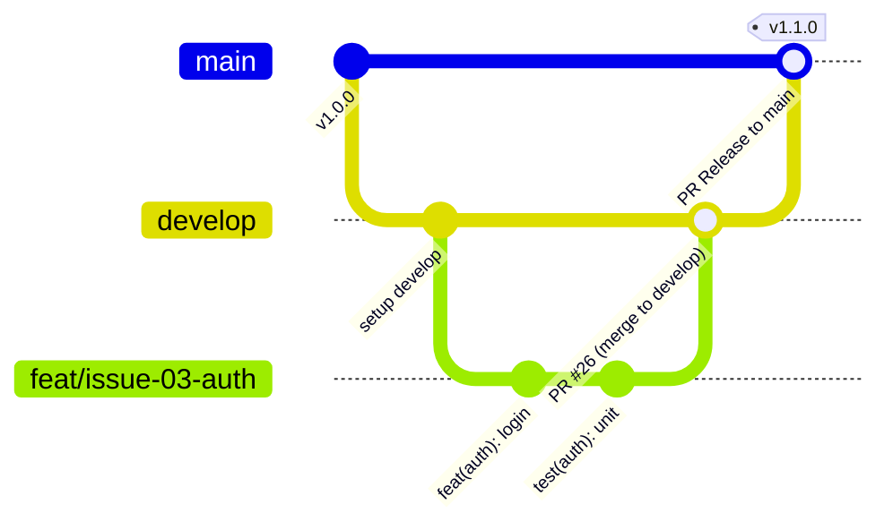

# Flujo de Trabajo en Git (GitFlow Simplificado) - Camino Seguro

Este documento define la estrategia oficial de ramificación, ciclo de vida de Pull Requests y políticas de integración para el repositorio `Code-Dev-2026/backend`.

---

## 1. Ramas Principales y Políticas de Protección

| Rama | Propósito | Criterio de Estabilidad | Commits Directos |
|---|---|---|:---:|
| `main` | Rama de producción. Refleja el estado desplegable y validado del sistema. | Máxima (código probado y validado en integración). | **PROHIBIDOS** |
| `develop` | Rama de integración continua. Punto de convergencia de todas las features. | Alta (compilación limpia, tests unitarios, E2E y migraciones al 100%). | **PROHIBIDOS** |

> **REGLA DE ORO:** Nunca hacer commits directos en `main` ni en `develop`. Todos los cambios ingresan exclusivamente a través de Pull Requests revisados y aprobados.

---

## 2. Ciclo de Vida de Desarrollo por Issue

El flujo estándar sigue la jerarquía: **`feature branch` $\rightarrow$ `develop` $\rightarrow$ `main`**.



---

## 3. Guía Paso a Paso para Desarrolladores

### Paso 1: Crear la rama feature desde `develop`
Antes de comenzar a trabajar en cualquier issue, sincroniza tu entorno local con `develop` y crea una nueva rama descriptiva:

```bash
# 1. Asegurarse de estar en develop y actualizado
git checkout develop
git pull origin develop

# 2. Crear rama específica para la issue
git checkout -b feat/issue-XX-nombre-descriptivo
# Ejemplos:
# git checkout -b feat/issue-03-auth-jwt-roles
# git checkout -b fix/issue-15-ajuste-validacion-coordenadas
# git checkout -b docs/issue-22-especificacion-openapi
```

#### Convención de nombres de rama:
* `feat/issue-XX-descripcion-corta` (nuevas características)
* `fix/issue-XX-descripcion-corta` (correcciones de bugs)
* `docs/issue-XX-descripcion-corta` (documentación)
* `test/issue-XX-descripcion-corta` (pruebas y suites de calidad)
* `refactor/issue-XX-descripcion-corta` (refactorizaciones sin cambio funcional)

---

### Paso 2: Desarrollo y commits atómicos
Realizar commits siguiendo el estándar **Conventional Commits**:
```bash
git add <archivos-modificados>
git commit -m "feat(auth): implementar firma y validacion de refresh tokens (#3)"
```

---

### Paso 3: Abrir Pull Request hacia `develop`
Una vez completada la tarea y verificadas las pruebas locales:

1. Sube tu rama al remoto:
   ```bash
   git push -u origin feat/issue-XX-nombre-descriptivo
   ```
2. Crea el Pull Request en GitHub seleccionando como **base branch:** `develop` (¡NUNCA `main`!).
3. Vincula formalmente la issue en la descripción del PR usando la palabra clave de cierre:
   ```markdown
   Closes #XX
   ```
   *(Donde `XX` es el número real de la issue en GitHub, por ejemplo: `Closes #3`)*.

---

### Paso 4: Integración y Pruebas en `develop`
En `develop` se ejecutan las validaciones automatizadas y pruebas de regresión:
* Compilación del backend (`npm run build`).
* Linter y formateo (`npm run lint`).
* Pruebas unitarias e integración (`npm run test`, `npm run test:e2e`).
* Verificación de migraciones de base de datos (`verify-migrations.sh` / `.ps1`).

---

### Paso 5: Promoción de `develop` a `main` (Release)
Cuando un hito o conjunto de issues en `develop` se encuentra consolidado, probado y estable:

1. Se abre un PR de `develop` hacia `main`.
2. Se realiza la revisión final por el Tech Lead / DevOps.
3. Al aprobarse y mezclarse, `main` se etiqueta con el tag de versión correspondiente (e.g. `v1.0.0`).
4. `main` nunca recibe código que no haya sido previamente integrado y probado en `develop`.

---

## 4. Resumen de Reglas Estrictas

1. **Origen:** Toda nueva rama nace de `develop` actualizado.
2. **Destino PR:** Todo PR de desarrollo apunta a `develop`.
3. **Cierre de Issues:** Cada PR debe incluir `Closes #N` en el cuerpo para trazabilidad automática.
4. **Protección:** `main` solo recibe PRs originados desde `develop`.
5. **Inmutabilidad:** Cero commits directos en ramas protegidas (`main`, `develop`).
